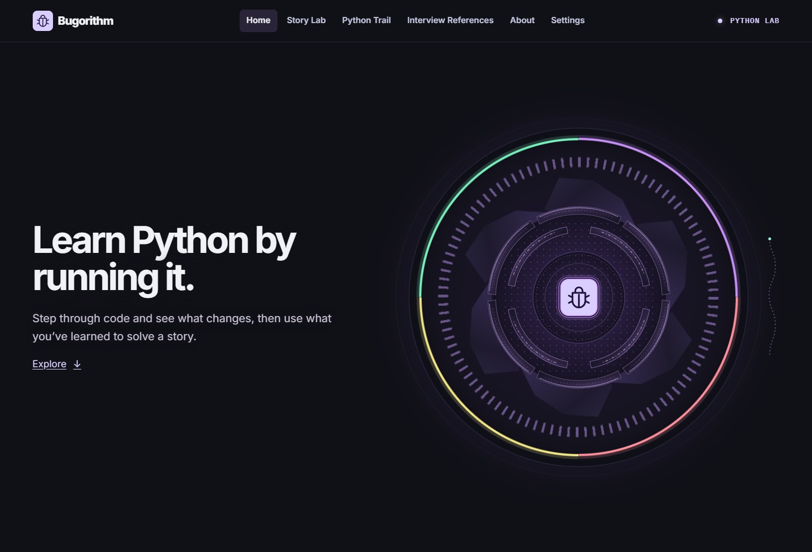
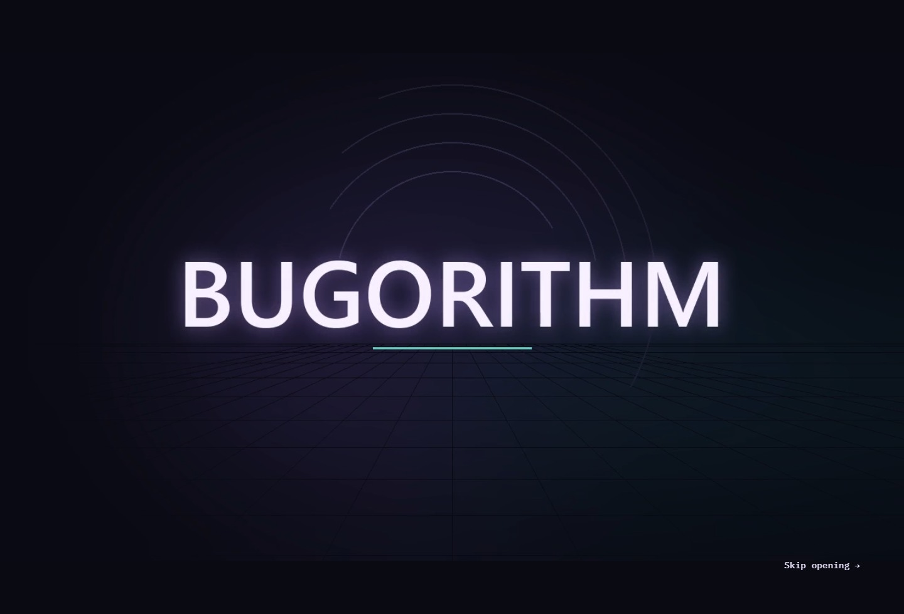
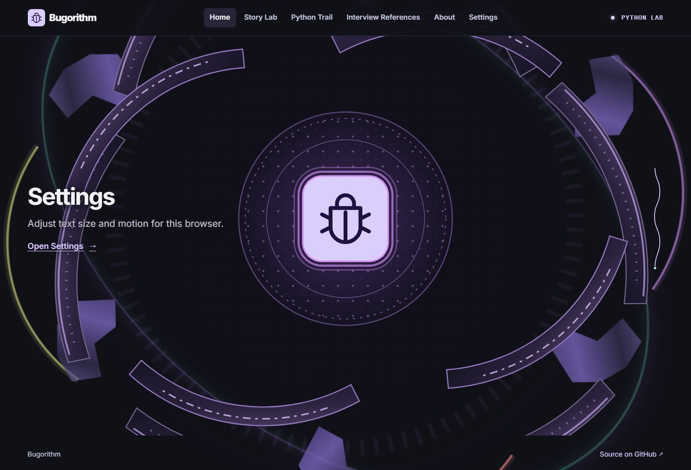
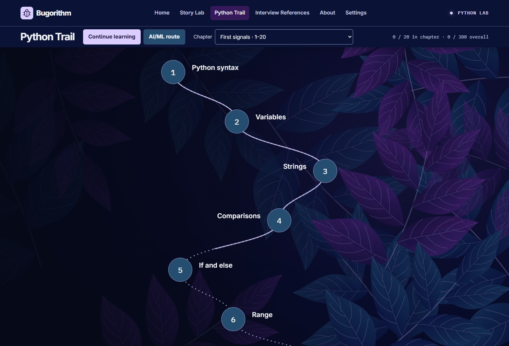
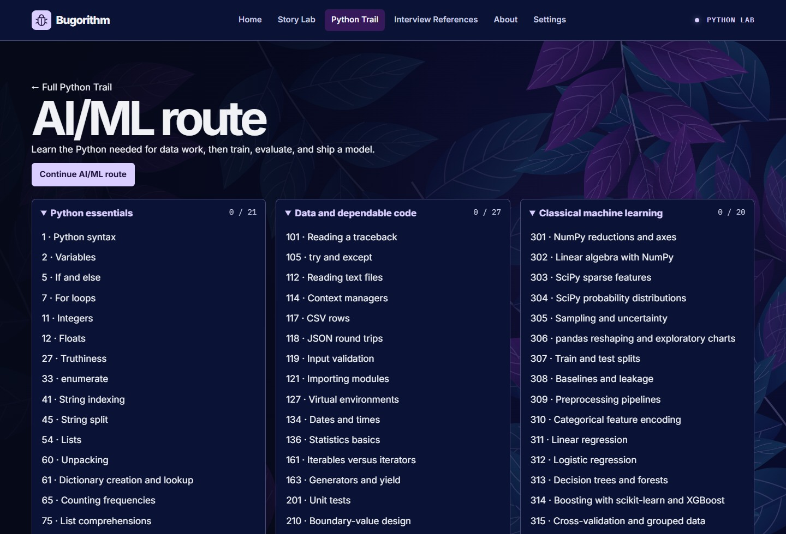
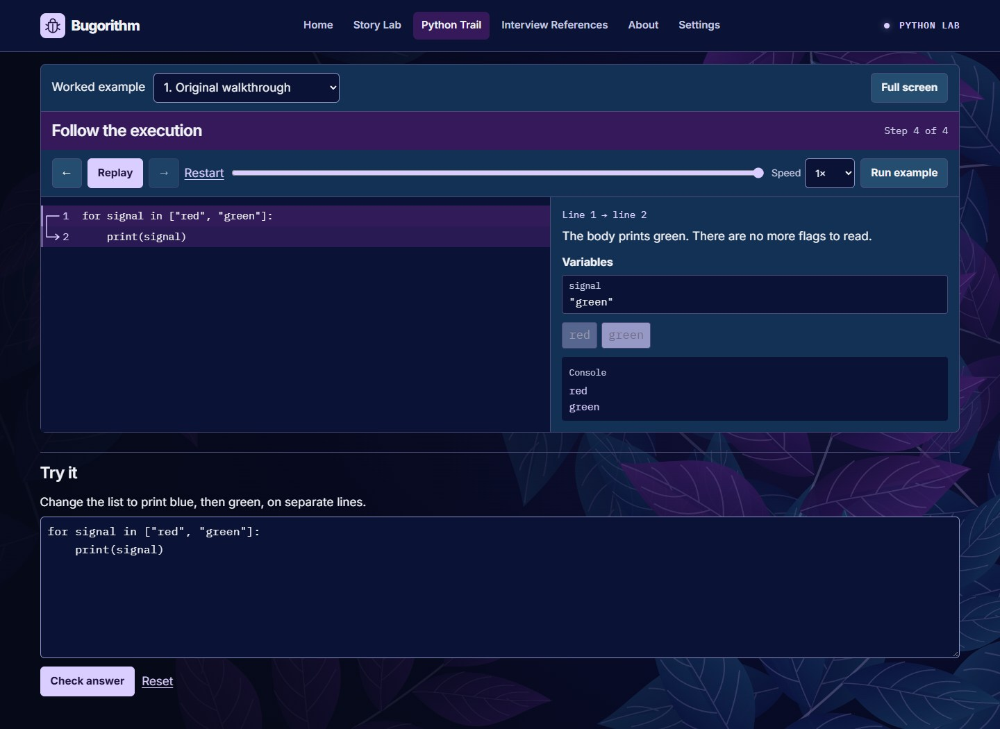
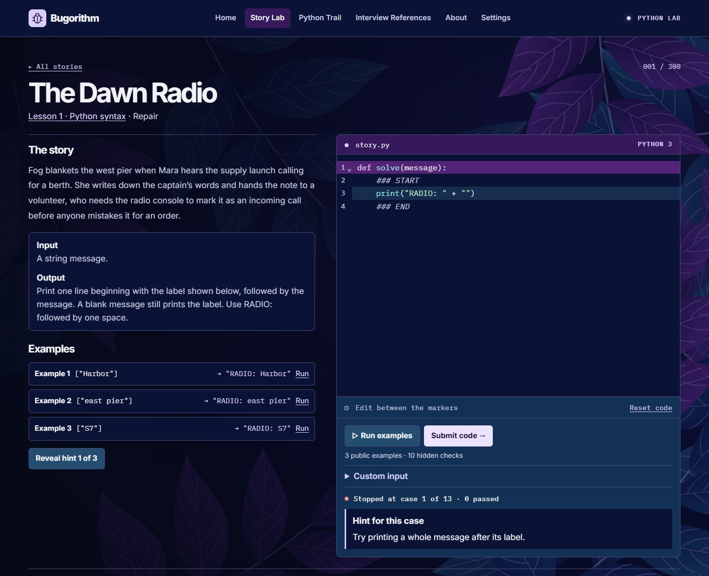
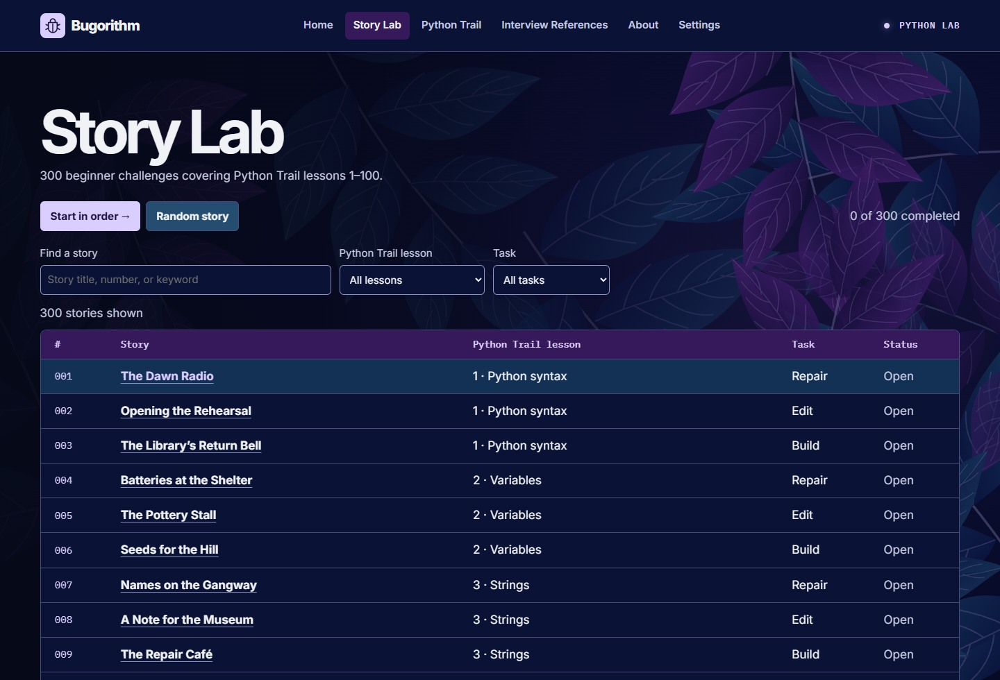

# Bugorithm

Bugorithm is a self-paced Python learning site. Watch a program execute line by line, see how its variables change, then edit or write code to solve a short story. You can start with your first Python statement or follow a focused route into data science and machine learning.

**[Open the hosted site](https://sahilshah2904.github.io/Bugorithm/)** · [v0.0.7 release](https://github.com/sahilshah2904/Bugorithm/releases/tag/v0.0.7)

[How to use it](#how-to-use-it) · [What you can learn](#what-you-can-learn) · [Screenshots](#screenshots) · [How it was built](#how-it-was-built) · [Run locally](#run-locally)

> The features and screenshots below describe the **development preview**, which has 380 Python Trail lessons and 300 Story Lab challenges. The published v0.0.7 milestone has 100 lessons and the Last Shuttle debugging exercise.

[](docs/images/readme/home.jpg)

## How to use it

1. **Start in Python Trail.** Open the first lesson or use the chapter menu to find a topic. Each lesson explains the idea, shows a worked example, and gives you a short exercise.
2. **Follow the execution.** Play the trace or step through it at your own pace. The active line, flow arrow, variables, and console show how Python gets from the input to the result.
3. **Try the idea in Story Lab.** Browse by lesson or by task type. Read the scenario and its input and output rules, then repair, adapt, or write Python in the editor.
4. **Test and revise.** Run the three public examples individually or together, or supply your own input. Reveal up to three hints in order. On submission, grading stops at the first failed check and explains the behavior to investigate.
5. **Choose what to learn next.** Continue through the full Trail, use the focused AI/ML route, or browse Interview References by topic. Lesson progress, story drafts, and display preferences are saved in the current browser.

### Why it helps

- **See what your code does.** Step through a loop, function, or branch while watching the values and output change together.
- **Practice the same idea in different ways.** The first 100 lessons each have three story exercises covering repair, edit, and build tasks.
- **Learn to test edge cases.** Each story has ten additional checks. The failure clue gives you a direction for debugging while the failing input and expected result stay hidden in the interface.
- **Work at your own pace.** Replay examples, rerun exercises, and adjust text size or motion in Settings. Beginner lessons run in your browser. Some advanced frameworks and system topics include a downloadable lab for local Python.

## What you can learn

| Section | What you can do |
| --- | --- |
| **Python Trail** | Follow 380 lessons across 19 chapters, from syntax, collections, and functions to testing, typing, concurrency, data work, and an AI/ML capstone. |
| **Story Lab** | Solve 300 beginner stories mapped to Trail lessons 1–100. Choose the next unsolved story, search for a topic, or pick a random story from your current filters. |
| **AI/ML route** | Follow a selected sequence from Python foundations through scientific computing, classical ML, deep learning, language and vision, and model deployment. |
| **Interview References** | Browse 100 external interview questions organized by topic. |
| **Settings** | Change interface text size and motion. Reduced motion bypasses the opening film and animated effects. |

### Libraries in the curriculum

| Area | Examples |
| --- | --- |
| Scientific computing and data | NumPy, pandas, SciPy, Matplotlib, Seaborn, Plotly, Polars, PyArrow, DuckDB, SQLAlchemy |
| Machine learning and statistics | scikit-learn, statsmodels, XGBoost, LightGBM, CatBoost, Optuna |
| Deep learning, text, and vision | PyTorch, TensorFlow and Keras, JAX, Hugging Face Datasets and Transformers, OpenCV |
| Testing, reproducibility, and deployment | pytest, Hypothesis, mypy, MLflow, ONNX and ONNX Runtime, Pydantic, FastAPI |

These are tools you practice with in the curriculum. The website itself uses the browser stack below. Scientific packages supported by the browser runtime load when needed. Other exercises provide lab files and setup instructions. [Curriculum notes](docs/PYTHON_TRAIL.md)

## Screenshots

Select a screenshot to open it at full size. All captures show the local development build with a fresh browser profile.

| Opening film | Reactor at the end of Home |
| --- | --- |
| [](docs/images/readme/opening.jpg) | [](docs/images/readme/reactor.jpg) |

| Python Trail map | AI/ML route |
| --- | --- |
| [](docs/images/readme/trail.jpg) | [](docs/images/readme/ai-route.jpg) |

| Worked execution trace | Story Lab workspace |
| --- | --- |
| [](docs/images/readme/lesson.jpg) | [](docs/images/readme/story-workspace.jpg) |

<details>
<summary>See the Story Lab catalog</summary>

[](docs/images/readme/story-catalog.jpg)

</details>

## How it was built

| Area | Technology | Role |
| --- | --- | --- |
| Browser interface | HTML, CSS, JavaScript modules, Inter, IBM Plex Mono | Renders the learning routes, responsive layouts, typography, and accessible controls. |
| Python runtime | Pyodide 0.29.3, CPython 3.13, WebAssembly, Web Workers | Runs Python in the browser worker so the interface stays available during a run. |
| Story Lab editor | CodeMirror 6, its Python language package, and Lezer highlighting | Provides a syntax-highlighted editor with an editable region, undo, and draft recovery. |
| Execution traces | Recorded CPython runs and a browser trace player | Captures line transitions, local values, and output, then replays them alongside the example code. |
| Grading | Python case runners and JavaScript result checks | Checks story submissions in order, runs public and custom examples, and grades lesson exercises or local lab reports. |
| Motion and graphics | Anime.js 4, Web Animations API, CSS, SVG | Drives interface transitions, the scroll-linked reactor, progress paths, and celebrations. |
| Opening film | Python, Pillow, FFmpeg | Renders the coding sequence and encodes the self-hosted MP4. |
| Progress and preferences | Web Storage | Saves drafts, completion, and preferences on the current browser. |
| Build and publishing | Node.js 24, npm, Vite 8, GitHub Actions, GitHub Pages | Bundles the static site, runs repository checks, and publishes successful builds from the main branch. |

## Run locally

Install **Git** and **Node.js 24**. Clone the repository and start the web app.

```sh
git clone https://github.com/sahilshah2904/Bugorithm.git
cd Bugorithm/apps/web
npm ci
npm run dev
```

Open the local URL printed by Vite. The checkout you run determines the features you see. Use `npm run build` to create `apps/web/dist/` and `npm run preview` to serve the production build locally. The build copies the pinned Pyodide runtime into the site.

### Verify the development preview

Install **Python 3.13** for the curriculum and fixture checks. From `apps/web/`, run:

```sh
npm run check:stories
npm run check:trail
npm run build
```

The checks verify the Story Lab cases, lesson and recording coverage, AI/ML prerequisites, downloadable lab assets, and production build. [Web app setup](apps/web/README.md) · [Release process](docs/RELEASING.md)

## Repository guide

| Path | What’s there |
| --- | --- |
| [`apps/web/`](apps/web/) | Site source, curriculum, Python runner, and build scripts |
| [`content/`](content/) | Public content and reference material |
| [`services/judge/`](services/judge/) | Plans for a separate private submission judge |
| [`docs/`](docs/) | Curriculum notes, roadmap, release instructions, and screenshots |
| [`.github/workflows/`](.github/workflows/) | Repository checks and GitHub Pages deployment |

[Contributing](CONTRIBUTING.md) · [Changelog](CHANGELOG.md) · [Roadmap](docs/ROADMAP.md)
